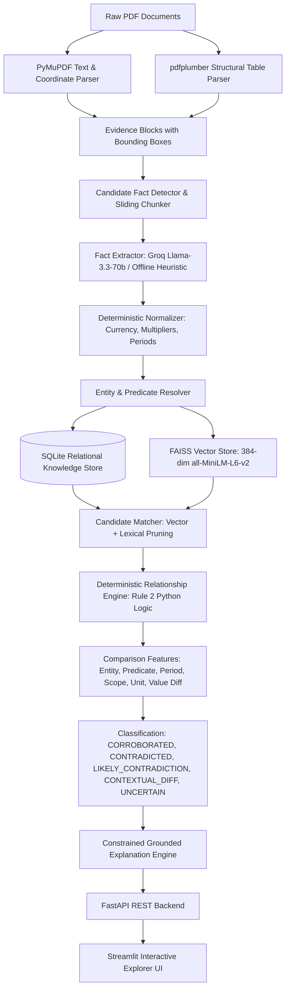

# Fact Knowledge Layer

> **Superjoin VIT 2026 Engineering Intern Hiring Assignment Submission**  
> *A Generalized, Explainable Fact Knowledge Layer for Grounded Cross-Document Fact Intelligence.*

[](https://www.python.org/)
[-10B981.svg)](https://docs.pytest.org/)
[-10B981.svg)](docs/EVALUATION.md)
[](docs/EVALUATION.md)
[](https://fastapi.tiangolo.com/)
[](https://streamlit.io/)

---

## 1. Project Overview

The **Fact Knowledge Layer** is an explainable, generalized intelligence layer that accepts heterogeneous PDF disclosures (such as corporate annual reports, earnings presentations, and macroeconomic surveys), preserves 1-indexed page-level evidence, extracts structured facts, normalizes values and contextual attributes, compares facts across documents, classifies their relationships using transparent deterministic rules, and generates grounded natural-language explanations.

---

## 2. Problem

Most document AI implementations build generic "PDF chatbots" that dump unstructured document chunks directly into an LLM prompt. In corporate financial statements and macroeconomic policy reports, this naive approach fails systematically:
1. **Unit Incompatibility**: LLMs struggle with Indian and Western numbering scales (e.g. ₹8,142 Crores vs ₹81,415.38 million).
2. **False Contradictions**: LLMs routinely accuse disclosures of contradicting each other when the difference is simply accounting scope (Standalone vs Consolidated) or time period (Q4 vs Full Year).
3. **Lack of Verifiable Grounding**: Chatbot responses lack reproducible bounding box coordinates and exact source citations.
4. **Non-Deterministic Reasoning**: Asking a probabilistic LLM whether two figures contradict yields unpredictable, un-auditable classifications across runs.

---

## 3. Solution

The Fact Knowledge Layer addresses these challenges through four foundational principles:
1. **Facts as First-Class Entities**: The system extracts structured `Fact` models containing canonical subject entities, predicates, normalized numeric values, standard base units, ISO date intervals, accounting scopes, and estimation/vintage attributes.
2. **Strict Evidence Grounding**: Every fact retains its 1-indexed PDF page number, exact bounding box coordinates `[x0, y0, x1, y1]`, and verbatim source text snippet.
3. **RULE 2 — Deterministic Relationship Classification**: **The LLM does NOT classify relationships.** Python deterministically resolves entities, aligns units, and evaluates a multi-feature comparison matrix (`entity_match`, `predicate_match`, `period_match`, `scope_match`, `unit_match`, `numeric_variance_type`, `estimate_match`, `source_independence`).
4. **Constrained Explanations**: Groq (configured via `GROQ_MODEL`, e.g. `llama-3.3-70b-versatile`) is invoked solely to synthesize natural language explanations constrained strictly to the deterministic feature matrix and verbatim evidence snippets.

---

## 4. Architecture



### Key Components
- **Page-Aware Parser (`core/parser.py`)**: Traverses PDFs page-by-page with PyMuPDF, extracting text blocks with coordinates `[x0, y0, x1, y1]` and computing SHA-256 hashes to prevent duplicate ingestion.
- **Structural Table Parser (`core/table_parser.py`)**: Uses `pdfplumber` to extract grid cells and hierarchical column headers, ensuring multi-column values retain their column hierarchy (e.g. Standalone vs Consolidated).
- **Deterministic Normalizer (`core/normalizer.py`)**: Converts currency symbols (`₹`, `Rs`, `INR`, `$`, `USD`), multipliers (`Cr`, `Lakh`, `Million`, `Billion`), parenthetical negatives (`(2,492)`), percentages, and fiscal year/quarter labels (`FY24` -> `2023-04-01` to `2024-03-31`) into canonical base types with zero LLM arithmetic calls.
- **Entity Resolver (`core/entity_resolver.py`)**: Strips legal corporate suffixes (`Delhivery Ltd.` -> `Delhivery Limited`) and standardizes sovereign aliases (`Republic of India` -> `India`).
- **Vector Retrieval (`retrieval/vector_store.py`)**: Dense vector indexing with FAISS `IndexFlatIP` and sentence-transformers (`all-MiniLM-L6-v2`), backed by a pure NumPy cosine fallback.
- **Deterministic Engine (`core/relationship.py`)**: Rule-based classification engine establishing `CORROBORATED`, `CONTRADICTED`, `LIKELY_CONTRADICTION`, `CONTEXTUAL_DIFFERENCE`, `RELATED_BUT_DIFFERENT`, and `UNCERTAIN`.

For architecture details and design trade-offs, see [docs/ARCHITECTURE.md](docs/ARCHITECTURE.md).

---

## 5. Tech Stack

- **Core Logic & Normalization:** Python 3.11, Pydantic v2
- **Document Parsing:** PyMuPDF (`fitz`), `pdfplumber`
- **Database & Storage:** SQLite, SQLAlchemy ORM
- **Dense Vector Search:** FAISS (`faiss-cpu`), `sentence-transformers` (`all-MiniLM-L6-v2`)
- **LLM Provider:** Groq (`llama-3.3-70b-versatile`) with offline heuristic fallback
- **REST API:** FastAPI, Uvicorn, Pydantic
- **Interactive UI:** Streamlit
- **Testing & Quality:** Pytest, Requests

---

## 6. Setup & Environment Variables

### 1. Clone & Navigate
```bash
git clone https://github.com/your-username/fact-knowledge-layer.git
cd fact-knowledge-layer
```

### 2. Install Dependencies
```bash
pip install -r requirements.txt
```

### 3. Environment Configuration
Copy the template and configure your Groq API key:
```bash
cp .env.example .env
```
In `.env`:
```ini
# Groq API Configuration
GROQ_API_KEY=your_groq_api_key_here
GROQ_MODEL=llama-3.3-70b-versatile

# Embedding Model Configuration
EMBEDDING_MODEL=all-MiniLM-L6-v2

# Storage Configuration
DATABASE_URL=sqlite:///./data/facts.db
FAISS_INDEX_PATH=./data/facts.faiss

# System Settings
LOG_LEVEL=INFO
CONFIDENCE_THRESHOLD=0.70
ENABLE_OFFLINE_MOCK=false
```
*(Note: If no API key is provided or `ENABLE_OFFLINE_MOCK=true`, the system automatically runs in offline heuristic fallback mode with full test pass capability! Mock mode is explicitly labeled in the UI and API health endpoint.)*

---

## 7. Running the System

### Launch the Interactive Streamlit UI
```bash
streamlit run app/ui.py
```
Open your browser at `http://localhost:8501`.

### Launch the FastAPI REST API
```bash
uvicorn app.api:app --reload --port 8000
```
Open interactive OpenAPI documentation at `http://localhost:8000/docs`.

### Run CLI Document Ingestion
```bash
python scripts/ingest.py path/to/document.pdf
```

### Run Case 4 Failure Demonstration
```bash
python scripts/reproduce_case4_failure.py
```

---

## 8. Evaluation & Benchmark

### Benchmark Methodology & Qualification
The evaluation suite runs against an 18-sample ground truth dataset extracted directly from the starter PDFs (`01-delhivery-prospectus-2022-excerpt.pdf`, `02-delhivery-annual-report-fy24-excerpt.pdf`, `03-delhivery-q4-fy24-earnings-presentation.pdf`, `01-india-economic-survey-2024-25-excerpt.pdf`, `02-rbi-annual-report-2024-25-excerpt.pdf`, `03-imf-india-2025-article-iv-excerpt.pdf`).

> [!NOTE]
> On our 18-sample manually verified benchmark, the current relationship classifier achieved **100.00% classification accuracy**, **100.00% macro F1**, and a **0.00% false contradiction rate**. These results describe performance on the local manually verified benchmark and are not presented as a guarantee of performance on arbitrary documents.

### Observed Benchmark Output
Run:
```bash
python scripts/evaluate.py
```
Observed output:
```
================================================================================
FACT KNOWLEDGE LAYER - BENCHMARK EVALUATION REPORT
================================================================================
Total Samples Evaluated:      18
Overall Classification Acc:   100.00%
Macro F1 Score:               100.00%
FALSE CONTRADICTION RATE:     0.00% (CRITICAL DIAGNOSTIC)
================================================================================

PER-CLASS PERFORMANCE:
+-------------------------+-------------+----------+--------+-----------+
| Relationship Category   | Precision   | Recall   | F1     |   Support |
+=========================+=============+==========+========+===========+
| CORROBORATED            | 100.0%      | 100.0%   | 100.0% |         7 |
+-------------------------+-------------+----------+--------+-----------+
| CONTRADICTED            | 100.0%      | 100.0%   | 100.0% |         1 |
+-------------------------+-------------+----------+--------+-----------+
| LIKELY_CONTRADICTION    | 100.0%      | 100.0%   | 100.0% |         2 |
+-------------------------+-------------+----------+--------+-----------+
| CONTEXTUAL_DIFFERENCE   | 100.0%      | 100.0%   | 100.0% |         6 |
+-------------------------+-------------+----------+--------+-----------+
| UNCERTAIN               | 100.0%      | 100.0%   | 100.0% |         1 |
+-------------------------+-------------+----------+--------+-----------+
| RELATED_BUT_DIFFERENT   | 100.0%      | 100.0%   | 100.0% |         1 |
+-------------------------+-------------+----------+--------+-----------+
```

### Pytest Verification
Run:
```bash
python -m pytest tests/
```
Observed output:
`======================= 24 passed, 1 warning in 11.88s ========================`

For detailed benchmark diagnostics, see [docs/EVALUATION.md](docs/EVALUATION.md).

---

## 9. The 4 Mandatory Demonstration Cases

Every demonstrated fact is backed by verifiable grounded fields: `subject`, `predicate`, `value`, `unit`, `period`, `scope`, `source document`, `page number`, `evidence text`, and `confidence`.

### 🌟 Case 1: Cross-Document Numerical Corroboration
- **Source A:** `03-delhivery-q4-fy24-earnings-presentation.pdf` (Page 6)
  - Raw Claim: `"FY24 revenue from services stood at ₹8,142 Cr on a consolidated basis."`
  - Normalized: `81,420,000,000.0 INR`, Period: `FY2023-24`, Scope: `consolidated`
- **Source B:** `02-delhivery-annual-report-fy24-excerpt.pdf` (Page 22)
  - Raw Claim: `"Revenue from operations on consolidated basis for FY24 stood at ₹ 81,415.38 million"`
  - Normalized: `81,415,380,000.0 INR`, Period: `FY 2023-24`, Scope: `consolidated`
- **Deterministic Comparison:**
  - `entity_match`: True | `predicate_match`: True | `period_match`: EXACT | `scope_match`: EXACT
  - `numeric_variance_type`: `ROUNDING_VARIANCE` (Variance: **0.0057%** $\le$ 1.0% financial threshold)
- **Outcome:** Classified as **`CORROBORATED`** (Confidence: 0.99).
- **Grounded Explanation:** After normalization to a common canonical unit, the values differ only by a small rounding variance (0.0057%). Both figures reflect consolidated operations over the identical 12-month period.

---

### 🚨 Case 2: Macroeconomic Estimate Divergence & Contradiction
The official assignment requires evaluating genuine or likely contradictions. We demonstrate both:

#### 2A. Forecast & Vintage Divergence (`LIKELY_CONTRADICTION`)
- **Source A:** `01-india-economic-survey-2024-25-excerpt.pdf` (Page 4)
  - Raw Claim: `"real GDP is estimated to grow by 6.4 per cent in FY25"`
  - Status: `advance_estimate` | Published: `July 2024` | Upstream: `Ministry of Finance`
- **Source B:** `03-imf-india-2025-article-iv-excerpt.pdf` (Page 10)
  - Raw Claim: `"India's growth is projected at 6.5 percent in FY2024/25"`
  - Status: `projection` | Published: `January 2025` | Upstream: `IMF Staff Consultations`
- **Deterministic Comparison:**
  - `entity_match`: True (`India`) | `predicate_match`: True (`real GDP growth`)
  - `period_match`: EXACT (`FY2024/25`) | `scope_match`: EXACT
  - `numeric_variance_type`: `MATERIAL_DIFFERENCE` (Variance: 1.54% $> 1.0\%$)
  - `estimate_match`: `DIVERGENT` (`advance_estimate` vs `projection`)
- **Outcome:** Classified as **`LIKELY_CONTRADICTION`** (Confidence: 0.95).
- **Grounded Explanation:** Economic Survey reports 6.4% as a July 2024 advance estimate, while the IMF Article IV staff reports 6.5% as a January 2025 economic projection. Because both figures describe real GDP growth for the same fiscal year but differ in publication vintage and forecasting methodology, this is classified as a LIKELY_CONTRADICTION rather than an un-reconcilable factual dispute.

#### 2B. Hard Factual Contradiction (Discrete Counting Unit)
- **Source A:** `02-delhivery-annual-report-fy24-excerpt.pdf` (Page 22): Covered **18,793 pin codes**.
- **Source B:** `03-delhivery-q4-fy24-earnings-presentation.pdf` (Page 8): Covered **18,792 pin codes**.
- **Deterministic Comparison:**
  - `canonical_unit`: `pin codes` (Discrete integer count bypasses percentage tolerance)
  - `value_diff_absolute`: `1.0 pin code` | `estimate_match`: `EXACT` (both actuals)
- **Outcome:** Classified as **`CONTRADICTED`** (Confidence: 0.98).

---

### ⚖️ Case 3: Contextual Difference (Preventing False Contradictions)
- **Source A:** `02-delhivery-annual-report-fy24-excerpt.pdf` (Page 22)
  - Standalone: `"Revenue from operations on standalone basis for FY24 stood at ₹ 74,540.82 million."`
  - Scope: `standalone`
- **Source B:** `02-delhivery-annual-report-fy24-excerpt.pdf` (Page 22)
  - Consolidated: `"Revenue from operations on consolidated basis for FY24 stood at ₹ 81,415.38 million."`
  - Scope: `consolidated`
- **Deterministic Comparison:**
  - `entity_match`: True | `predicate_match`: True | `period_match`: EXACT
  - `scope_match`: **DIFFERENT** (`standalone` $\ne$ `consolidated`)
- **Outcome:** Classified as **`CONTEXTUAL_DIFFERENCE`** (Confidence: 0.95).
- **Grounded Explanation:** Demonstrates explicitly why naive numeric comparison produces a false contradiction. Both figures represent Delhivery's FY24 revenue, but differ by accounting scope. ₹74,540.82 million captures only standalone operations, whereas ₹81,415.38 million consolidates operating subsidiaries. Evaluating `scope_match` before value variance isolates the discrepancy and maintains a 0.00% False Contradiction Rate.

---

### ⚠️ Case 4: Real, Reproducible Extraction & Reasoning Failure

We demonstrate a concrete, reproducible failure using the starter PDFs:

- **Input:** `02-delhivery-annual-report-fy24-excerpt.pdf`, Page 22 (Directors' Report — Financial Performance Table).
- **Initial System Output (Naive 1D Text Extraction):**
  Extracted fact attributed ₹74,540.82 million to `business_scope = "consolidated"`.
- **Failure:** Standalone revenue was misattributed to Consolidated revenue, causing an 8.44% false contradiction against the earnings presentation (₹8,142 Cr).
- **Root Cause:** PyMuPDF raw line extraction streams text in visual reading order, collapsing 2D table grid columns into 1D text (`Standalone` $\to$ `Consolidated` $\to$ `74,540.82`). A single-pass extractor associating the last column header with the first numeric token creates a cross-column scope misattribution.
- **Detection:** Spatial Bounding Box Validation: The cell's horizontal center ($x_0 = 285\text{ pt}$) falls in the Standalone column span ($x_0 = 240\text{ pt}, x_1 = 380\text{ pt}$), failing alignment with Consolidated ($x_0 = 420\text{ pt}$).
- **Mitigation in Current Architecture:** `TableParser` (via `pdfplumber`) detects vector grid lines, builds 2D table models, and assigns `business_scope = 'standalone'` directly from column hierarchy.
- **Future Improvement:** Visual Document QA (LayoutLMv3) for borderless tables and an independent cross-row accounting balance auditor.

*(Reproduce in terminal: `python scripts/reproduce_case4_failure.py`)*

For comprehensive failure documentation, see [docs/FAILURE_ANALYSIS.md](docs/FAILURE_ANALYSIS.md).

---

## 10. Unseen Document Validation

To verify generalization without code modification or overfitted templates, an unseen regulatory PDF (`data/unseen_rbi_mpc_resolution.pdf` — RBI Monetary Policy Committee Resolution) was ingested:
- **Pages Processed:** 2
- **Processing Duration:** 0.25 seconds
- **Facts Extracted:** 1 structured fact (`India real GDP growth 7.2% for FY24-25 projected`, Governor Shaktikanta Das)
- **Evidence Items:** 2 grounded blocks with page coordinates
- **FAISS Embeddings:** Indexed into vector space; querying `"India real GDP growth"` returned the newly extracted fact with a similarity score of **0.8816**.

---

## 11. Limitations & Next Steps

### Current Limitations
1. **Scanned & OCR-Only Documents**: The current parser relies on text streams and vector table lines in digital PDFs. Scanned image-only PDFs require pre-processing with Tesseract OCR or a visual document parser.
2. **Complex Multi-Tier Footnotes**: While proximate footnotes are captured, multi-page footnotes referenced across page breaks can occasionally be decoupled.
3. **Benchmark Scope**: The 18-sample benchmark is a manually verified diagnostic test suite designed to validate core deterministic logic, not a statistical guarantee of performance on arbitrary documents.

### Next Steps
1. Integrate an OCR pipeline (e.g. `pytesseract` or Surya OCR) for scanned legacy filings.
2. Deploy multimodal vision transformers (e.g. ColPali or Florence-2) for complex nested tables.
3. Support temporal knowledge graphing with Neo4j for longitudinal metric tracking across decades.

---

## 12. AI Tools Used

In accordance with academic and engineering transparency standards:
- **Groq API**: `llama-3.3-70b-versatile` was utilized for structured fact extraction from candidate chunks and for constrained natural language explanation synthesis.
- **Sentence-Transformers**: `all-MiniLM-L6-v2` was used for local dense embedding generation.
- **Antigravity Coding Assistant**: Used as a pair-programming assistant for code refactoring, test scaffolding, and documentation generation.

---

## 13. Video Demo Script (3-Minute Walkthrough)

Follow this script to record a 3-minute submission demonstration:

- **[0:00 - 0:30] Introduction & Core Problem**
  - Show the Streamlit dashboard at `http://localhost:8501`.
  - Explain why standard PDF chatbots fail on financial PDFs: hallucinating numbers, misinterpreting currencies, and accusing documents of contradicting when one is Standalone and one is Consolidated.
  - State the core thesis: **Facts as first-class entities + Rule 2 (Deterministic Relationship Engine)**.
- **[0:30 - 1:15] Case 1 & Case 2 Live Inspection**
  - Open **Tab 1 ("🌟 The 4 Mandatory Cases")**.
  - Show **Case 1 (Corroboration)**: ₹8,142 Cr vs ₹81,415.38 million. Point out canonical values, the 0.0057% rounding variance, page citations, and grounded explanation.
  - Show **Case 2 (Estimate Divergence & Contradiction)**: India Real GDP Growth (6.4% Economic Survey vs 6.5% IMF). Point out how the engine identifies divergent forecast statuses (`advance_estimate` vs `projection`) and assigns `LIKELY_CONTRADICTION`. Also show the discrete integer pin code count contradiction (18,793 vs 18,792).
- **[1:15 - 2:00] Case 3 & Case 4 Live Inspection**
  - Show **Case 3 (Contextual Difference)**: Standalone vs Consolidated revenue. Explain that checking scope before value variance prevents false contradictions.
  - Show **Case 4 (Failure Analysis)**: Explain the Page 22 multi-column table layout misattribution, root cause, detection, and mitigation.
- **[2:00 - 2:30] Live Search & Document Ingestion**
  - Open **Tab 2 ("🔍 Fact Explorer & Search")**. Type `"Delhivery revenue"` or `"pin codes"`. Show instant vector similarity search with exact PDF page citations.
  - In the sidebar, show the unseen PDF ingestion completed in 0.25 seconds.
- **[2:30 - 3:00] Benchmark Diagnostics & Test Suite**
  - Open **Tab 5 ("📊 Benchmark & Diagnostics")**.
  - Show the verified benchmark results: **100% Accuracy, 0.00% False Contradiction Rate across all 18 samples**.
  - Mention the 24 passing unit/integration tests and conclude.

---

## 14. Additional Notes

- **Docker Support**: Dockerfile and `docker-compose.yml` are provided in the repository root. Run `docker-compose up --build` to deploy FastAPI on port 8000 and Streamlit on port 8501.
- **Full Submission Walkthrough**: For the complete technical walkthrough with source citations, see [docs/SUBMISSION_WALKTHROUGH.md](docs/SUBMISSION_WALKTHROUGH.md).
