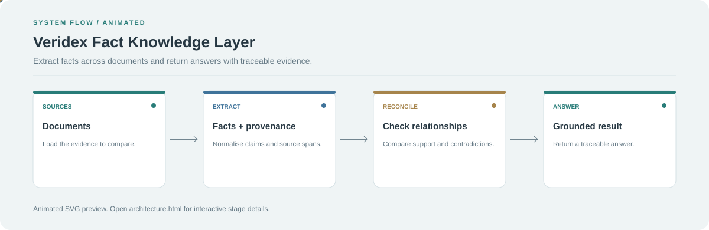

# Veridex Fact Knowledge Layer

**Extract facts across documents and return answers with traceable evidence.**

[](https://github.com/chyk2468/Veridex)

## 1. Project Title & Tagline

Extract facts across documents and return answers with traceable evidence.

## 2. Problem Statement

Answers from multiple documents can conflict or lack clear sources. Veridex focuses on extracting facts, retaining provenance, and comparing evidence before returning a grounded result.

## 3. Project Preview

Add a screenshot or GIF showing a representative workflow and its output. Remove sensitive or private information from any demo data.

[Open interactive architecture](architecture.html)

## 4. Overview

The project moves from source input through its core processing stages to a result that can be reviewed. The workflow below shows the main system boundaries.

## 5. Key Features

- Extract structured claims from source documents.
- Keep provenance for the source of each fact.
- Compare relationships and possible contradictions.
- Return answers with traceable evidence.

## 6. Architecture / Workflow



Open the [interactive architecture explorer](architecture.html) to select a stage and inspect its role.

## 7. Tech Stack

Python and the parsing, retrieval, evaluation, and UI libraries configured by the repository

## 8. Installation & Setup

```bash
git clone https://github.com/chyk2468/Veridex.git
cd Veridex
```

Follow the repository's Python environment and configuration instructions before running the pipeline.

## 9. Usage

Load a small set of related documents, run the extraction and reconciliation workflow, and inspect the supporting evidence for each returned fact. Review uncertain or conflicting claims manually.

## 10. Project Structure

Inspect the ingestion and parsing modules, fact representation, provenance storage, reconciliation logic, evaluation scripts, and UI.

## 11. Results & Demo

Add a benchmark with source documents, expected facts, contradiction cases, and measured extraction/retrieval quality. Avoid claiming accuracy without reproducible results.

## 12. Future Enhancements

- Add provenance coverage metrics.
- Improve contradiction detection.
- Add tests for missing or conflicting evidence.
- Expose source excerpts alongside each result.

## 13. License

Check the repository and dataset licences before reuse. Verify the source and model licences for any bundled dependencies.
